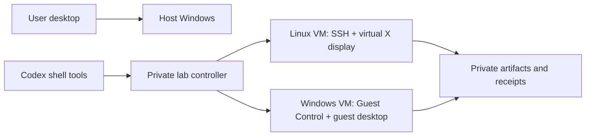

# Independent Windows and Linux development lab

Reviewed and implemented locally on 2026-10-12. The user's goal is to let Codex build and test applications without occupying the user's desktop, mouse or keyboard.

**Current reference state:** Linux's selected browser/native/build/restore and user-present background slices passed. Windows is installed with firmware virtualization enabled; helper 0.7.6 passed selected transfer/build/UIA/CDP, timed work and a separate stopped-checkpoint restore. The completed Windows interval's human report passed with no interference; Windows activation remains pending. Read [the current handoff and exact versioned scope](ISOLATED-LAB-HANDOFF-2026-10-12.md). Embedded base [validation](../examples/isolated-lab/VALIDATION.json) is historical; destination readiness remains machine-local.

[Implementation](../examples/isolated-lab/README.md) · [Acceptance gates](#acceptance-gates) · [Resume boundary](#resume-boundary) · [Recovery](#recovery)

The 0.3.0 helper adds structured guest OS/process/file observations, a persistent headless browser with DOM/accessibility actions, and native Linux AT-SPI controls in a private D-Bus/Xvfb session. See [the guest-tool architecture and acceptance guide](ISOLATED-LAB-GUEST-TOOLS.md) and [Windows setup history](ISOLATED-LAB-WINDOWS-SETUP.md). Native Linux coverage is established for the tested GTK application. Release 0.4.0 adds [portable setup, user skill binding and guarded upgrades](ISOLATED-LAB-PORTABILITY.md) without changing the Linux guest helper. Later Windows source and acceptance are indexed by the current handoff.

## Recommended design

Use two persistent, headless VMs with separate virtual disks, guest identities and test outputs. Start them on demand, give each job a deadline, and shut them down when the requested test is finished. Keep guest execution separate from the user's host session.

For this PC, use VirtualBox for the permanent pair after enabling SVM. The current QEMU Linux guest is an immediately usable software-emulation acceptance route and recovery baseline. It is deliberately kept separate from the future native VM so a failed migration cannot destroy the working guest.

VirtualBox supports headless starts, guest process/file operations, screenshots and unattended OS installation. Guest Additions and an actual logged-in desktop remain separate dependencies for Windows GUI work. [Oracle command reference](https://docs.oracle.com/en/virtualization/virtualbox/7.2/user/vboxmanage.html), [Guest Additions](https://docs.oracle.com/en/virtualization/virtualbox/7.2/user/guestadditions.html).

Codex's permissions sandbox restricts a process's access; it does not supply a second Windows desktop or guest OS. The implemented route uses the current chat's existing shell tools to call the guest controller. No separate AI API account/key, recurring task or duplicated Codex sign-in is required for that route. [OpenAI Windows sandbox documentation](https://learn.chatgpt.com/docs/windows/windows-sandbox).

## Choices researched

| Choice | Benefit and fit | Dependency / limitation | Decision |
|---|---|---|---|
| 1. Two headless VirtualBox VMs — recommended | Persistent Windows and Linux, independent displays, supported guest CLI; fits Windows 11 Home | SVM enabled, host driver installed with administrator approval; Windows license/media; guest GUI session | Medium setup difficulty; high upstream confidence, local runtime pending. Rollback: preserve disks, uninstall host package through Windows |
| 2. Linux WSL2 + Windows VM | Convenient Linux builds and development tools | WSL installation needs elevated setup/restart; WSL integrates with host files/apps and is not a separate full desktop by default | Good optional later route; unnecessary second host virtualization setup now. [Microsoft WSL installation](https://learn.microsoft.com/en-us/windows/wsl/install) |
| 3. QEMU software emulation | Runs a guest without enabling SVM or installing a kernel driver | CPU emulation is slow; Windows hardware/TPM/media setup remains substantial | Used for the Linux acceptance baseline, not permanent fast-work acceptance. [QEMU acceleration and emulation](https://www.qemu.org/docs/master/system/introduction.html) |
| 4. Hyper-V / Windows Sandbox | Microsoft VM stack or disposable Windows environment | Edition/optional-feature requirements, reboot and licensing; disposable state unsuitable as the only persistent workspace | Not the first route on this Windows Home installation. [Hyper-V requirements](https://learn.microsoft.com/en-us/windows-server/virtualization/hyper-v/host-hardware-requirements) |
| 5. Docker / containers | Excellent repeatable CLI and web tests | Windows desktop apps need a Windows VM; containers do not create an interactive desktop session | Add inside a guest only when a project benefits |
| 6. Another physical or cloud machine | Strongest separation of CPU/GPU load from this PC | Separate hardware/cost, accounts, secure connectivity and data transfer | Optional if local resource contention later proves unacceptable |

The recommendation is an engineering judgment based on the observed host and the documented interfaces, not a measured comparison of hypervisors.

## Observed host prerequisites

- Windows 11 Home, build 26200; AMD Ryzen 7 5800X3D, 16 logical processors; about 64 GiB RAM.
- About 230 GiB free on the system drive and 432 GiB on the secondary drive at inspection.
- NVIDIA RTX 5070 Ti; no GPU passthrough is configured or promised.
- Firmware virtualization reported **False**; SLAT and VM monitor extensions reported supported.
- WSL not installed; no existing VirtualBox, VMware, QEMU or Docker installation was found in the scoped CLI/uninstall inspection.
- Current shell not elevated. No BIOS changes, host driver installation or reboot was performed.

The motherboard is ASUS ROG STRIX B550-I GAMING. ASUS documents enabling **SVM Mode** in **Advanced → CPU Configuration**. This is a physical firmware action; the chat cannot perform it from the current supported Windows tools. [ASUS instructions](https://www.asus.com/au/support/faq/1045141/).

## Implementation stages

1. **Private preparation — implemented.** Create a dedicated lab outside OneDrive and Git. Preserve a host preflight record, use a lab-only SSH key with restricted Windows permissions, verify downloaded QEMU/Ubuntu/VirtualBox checksums, and verify Oracle installer signatures. Keep source, third-party binaries and private recovery separate.
2. **Linux isolation — implemented; acceptance recorded below.** Boot a new 32 GiB copy-on-write guest under QEMU with 4 GiB RAM and two vCPUs. Use explicit TCG mode, no visible host window, loopback-only SSH/QMP/VNC and no host-folder/clipboard/USB sharing. Cloud-init creates the guest user and installs build and GUI-test tools.
3. **Fast host setup — prepared, blocked.** Enable SVM in firmware. Run the verified minimal VirtualBox installer with one administrator elevation. Install only the application/core virtualization driver; NAT needs no bridged/host-only networking or USB/Python host integration. Automatic reboot, manager launch, file associations and desktop shortcuts are suppressed. The prepared script defaults to read-only preflight unless `-Install` is supplied.
4. **Windows guest — prepared, blocked.** Use explicitly selected Windows 11 media and the proper edition index. Create a new 64 GiB guest with 8 GiB RAM, four vCPUs, 75% CPU execution cap, EFI, virtual TPM 2.0, NAT and Guest Additions. Disable clipboard, drag/drop, USB, remote desktop extension and audio. Dispatch the official unattended install headlessly and retain each step's private receipt.
5. **Permanent Linux guest — planned, not installed.** Use a supported Ubuntu installation ISO with VirtualBox's unattended route, or validate a cold conversion of the accepted Linux guest only after verifying its kernel/storage-driver compatibility. Keep the QEMU disk and credentials as an immutable recovery boundary. Do not call conversion a completed migration.
6. **Autonomous GUI routes — Linux browser and native AT-SPI slice accepted; Windows pending.** Native Linux apps run on a private guest D-Bus/Xvfb session with structured tree/text/actions and frozen-app recovery. For Windows, establish a dedicated guest interactive session and an in-guest test adapter; distinguish Guest Control service execution from desktop interaction. Prove input, screenshots and result readback before advertising Windows GUI readiness.
7. **Daily use — Linux implemented.** MCP registration and actual Codex client discovery, local skill with shell fallback, CLI lifecycle, structured inspection/action/readback, per-guest operation locks, finite deadlines, private artifacts and powered-off checkpoint/restore. This active chat's loaded MCP catalog needs a client refresh. Windows remains gated.

## Licensing and expected stops

A host Windows license must not be assumed to license an additional guest. The Windows route needs selected licensed media/key or a properly obtained Microsoft evaluation. No purchase or evaluation registration was performed.

Microsoft's Windows 11 Enterprise evaluation is 90 days. After expiration, Microsoft documents hourly shutdowns and other limitations, so it cannot be the basis for a promise of permanent unattended operation. Activation/remaining term must be part of the Windows preflight, with a licensed replacement before expiry. [Microsoft evaluation requirements](https://www.microsoft.com/en-us/evalcenter/evaluate-windows-11-enterprise).

The setup should fail with a specific cause when any of these is unknown or absent:

| Gate | Required evidence | Response |
|---|---|---|
| Firmware / host driver | SVM reported enabled; installed hypervisor can cold-boot guest | Stop setup, retain prepared files |
| Boot / bootstrap | Fresh successful SSH/Guest Additions handshake and setup-complete marker | Diagnose serial/install logs; bounded wait, no blind reinstall |
| Guest login / display | Actual interactive guest session and verified virtual display | No GUI dispatch until accepted |
| Windows activation | Valid license/activation and remaining evaluation term where applicable | State limitation and repair selected licensing route |
| Network / dependencies | Repository/DNS/download access needed by this selected project | Retain failure and report precise missing dependency |
| Resources | Enough current free RAM/disk; initial combined allocation about 12 GiB and six vCPUs | Stop or run one guest at a time; do not silently increase budgets |
| Job completion | Exit status, output artifacts and assertion about intended behavior | Nonzero/timeout is failure; preserve receipt, do not auto-replay |
| Session lifetime | Guest survives viewer closure; reboot/login/cold-start tested | Separate short smoke test from longer reliability |
| Account interaction | Required sign-in/2FA/license/device action completed by the owner | Request only the remaining unavoidable action |

No finite test proves that arbitrary software will never block. The objective is to handle known failure classes visibly and avoid taking host desktop ownership when they occur.

## Acceptance gates

The private lab receipt owns exact live results. Public evidence states must be updated from observed outcomes, not from a prepared script.

| Test | Pass evidence | Current observed state |
|---|---|---|
| Controller/guest failure paths | Reject escaping paths, oversized budgets, reused PID, duplicate operation, live-disk copy, corrupt recovery; UTF-8/binary transfer, preserved scoped SCP arguments, stale sessions and read-tool mutation rejection | 21 guard fixtures passed |
| Linux boot + bootstrap | Fresh key-only SSH and completed cloud-init marker | PASS; NoCloud over read-only virtio; cloud-init done without errors |
| Linux build | Compile and run a C program; Python result from guest | PASS |
| Linux GUI/input | Guest xterm receives text/Enter in private X server; result file and screenshot | PASS; repeated after restored-copy boot |
| Linux native app semantics | AT-SPI tree/text/state, editable text, exposed actions, exact result and failure recovery in private guest session | PASS 25 real checks; frozen app, provider exit and owned-group cleanup |
| Codex connection | Registered server, actual Codex client discovery and local skill/fallback | PASS five MCP tools and enabled skill; active chat still needs MCP refresh |
| Isolation | Loopback listeners, no mounted host user directory, no host input API | Guest-only implementation/routes accepted. Historical foreground samples are inconclusive for the present task; user observation pending while another chat controls host |
| Failure and timeout | Intentional nonzero script and deadline failure; next normal job succeeds | PASS; exit 17 retained, timeout 124 retained, following job passed |
| Viewer independence | Guest jobs work with no VM viewer/browser open | PASS; build, GUI and repeat jobs ran headlessly |
| Restart | Clean guest shutdown, cold boot and SSH without interactive login | PASS; cold boot in software emulation needed about one minute |
| Recovery | Powered-off checkpoint, new-disk restore and guest marker readback | PASS; hash-verified new disk booted; original preserved; marker and GUI readback passed |
| Windows installation and command | Completed install, correct OS/activation, Guest Additions and tested command | Blocked |
| Windows interactive GUI | Guest-only input/screenshot/readback after guest login, lock/restart recovery | Blocked |
| Simultaneous real user work | Both guests run their jobs while the user works; no input/focus/display ownership, acceptable load | Pending user/live acceptance |
| Longer unattended operation | Repeated build/browser/native jobs with meaningful status and bounded failures | PASS 1819.28 seconds, 73 cycles/742 requests, no errors. Failure/restart checks are separate accepted tests; not a promise that arbitrary tasks never fail |

These are application/lifecycle checks, not rendering benchmarks or GPU performance measurements. No game, HDR/FG test or input-device profile was launched or changed.

## Recovery

For the current Linux guest, stop it first, take a checkpoint with the controller, verify both overlay and backing-image hashes, and restore into a new disk. Preserve the current disk and private configuration. Boot the new copy and verify a known guest marker; a hash-only copy is not a restore test.

Never switch a running virtual disk. Windows recovery should use a powered-off VirtualBox snapshot/export after installation and separately pass a restore test; the current controller does not claim that Windows recovery is implemented.

To stop a stuck guest, first inspect its recorded process identity and logs, then use the explicit guest-scoped `force-stop` action. An operation lock left by an interrupted controller is not automatically removed: inspect the recorded owner before clearing that one lock. Force-stop may lose unflushed guest writes.

Uninstall the host hypervisor through Windows Apps only if later requested, preserving guest disks and private recovery. Current rollback requires no system uninstall because no hypervisor driver was installed.

## Resume boundary

1. Linux acceptance for the stated slice is complete; retain its private checkpoint and source receipt.
2. User enables **SVM Mode** in ASUS BIOS/UEFI and returns to Windows; the current chat cannot operate firmware.
3. Reinspect firmware/resources, install the already-verified minimal VirtualBox package with normal administrator consent, and observe the result.
4. Resolve legitimate Windows media/licensing, inspect the ISO edition list and provision the new Windows guest.
5. Validate Windows commands, actual guest GUI session, recovery, simultaneous-work and longer-job acceptance; only then route routine compatible app tests automatically to the lab.
6. Build/accept the permanent accelerated Linux guest without overwriting the QEMU baseline.

No reminder, future wakeup, cloud expense, background desktop watcher or global permission change is scheduled.
