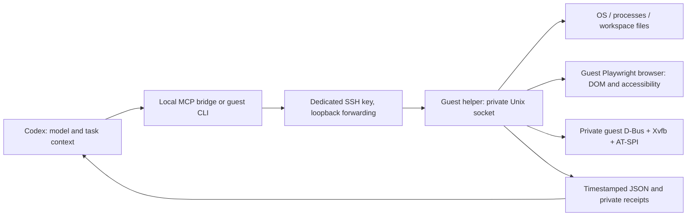

# Structured tools inside the development VM

The chat can read actual operating-system and application data inside a VM. A screenshot is one source of evidence; it is not the only interface. The new helper supplies structured requests and observations while the model and conversation remain in Codex on the host.

**Implementation boundary:** version 0.3.0 targets the accepted Linux guest, with structured system, browser and native application adapters. Runtime acceptance belongs to [the validation receipt](../examples/isolated-lab/VALIDATION.json). Windows remains unprovisioned. Installing a helper does not automatically duplicate every built-in Codex capability.

**Observed acceptance:** 21 guard fixtures, the earlier 35 live structured guest/browser checks and 25 new native application checks passed. Codex's actual MCP client discovered all five tools and the 0.3.0 native operation schemas. The GTK test read the accessibility tree, entered Unicode text, changed checked state, invoked a button and read its exact result. Stale state was rejected; frozen-app and unexpected-provider-exit recovery and owned-group cleanup passed. A 30-minute mixed background workload passed 73 cycles/742 structured requests over 1819.28 seconds with no errors. Simultaneous user-work acceptance remains pending: another chat was controlling the host, so the user could not observe isolation reliably.

[Daily use](#daily-use) · [Capabilities](#capabilities) · [Extensions](#extension-order) · [Acceptance](#acceptance-and-recovery)

## How it works



The browser runs headlessly **inside Linux**. A named session persists across separate requests until explicitly closed, the worker stops, or the VM shuts down. The host does not display or drive this browser. There is no guest TCP control service, additional host port, API key or AI model running inside the helper.

Codex supports local stdio MCP servers, including tool descriptions and server instructions. Its documented configuration is shared by the desktop app, CLI and IDE extension; a client/server restart may be needed to load a newly configured server. This is the connection mechanism, not a guarantee that a particular active chat has already loaded it. [Official OpenAI documentation](https://learn.chatgpt.com/docs/extend/mcp?surface=cli).

## Capabilities

| Source | Information or action | Current adapter boundary |
|---|---|---|
| Guest OS | Kernel/Python version, uptime, memory, CPU count/load and free workspace disk | Direct guest OS data; not host/GPU metrics |
| Processes | PID, name, state, resident memory; selected argv execution with deadline/exit/output | Guest scope; avoids enumerating environment variables or private command lines |
| Workspace files | List/read UTF-8 data and exclusively create a new file | Workspace-relative paths; refuses escaping paths and silent replacement |
| Browser | URL/title/text, semantic roles, accessible names and state; named-control fill/click/check/select/read | Playwright DOM/accessibility; real page data rather than OCR |
| Browser pixels | Screenshot saved in guest artifacts and fetched separately | Useful for appearance, canvas and visual evidence |
| Native Linux applications | Roles, names, states, text, interfaces and exposed actions; editable text and button actions | AT-SPI on a private guest D-Bus/Xvfb session; tested GTK app, not universal app coverage |
| Native Windows applications | Future UI Automation properties, patterns and events | Windows guest/session and adapter acceptance still required |

Playwright provides semantic locators and ARIA snapshots that expose roles, names and state derived from the page. They complement visual assertions; they do not establish how every pixel looks. [Playwright snapshots](https://playwright.dev/python/docs/aria-snapshots), [locator API](https://playwright.dev/python/docs/api/class-locator).

For Windows, UI Automation clients can retrieve control information and interact with exposed controls. Linux AT-SPI exposes names, roles, state and supported interfaces. Applications must expose usable information; a custom canvas or game may still require pixels and guest input. A Windows service or SSH login does not by itself establish an interactive accessibility session. [Microsoft UI Automation](https://learn.microsoft.com/en-us/windows/win32/winauto/entry-uiautocore-overview), [GNOME AT-SPI](https://gnome.pages.gitlab.gnome.org/at-spi2-core/libatspi/class.Accessible.html).

## Daily use

The MCP bridge exposes `lab_status`, `lab_start_linux`, `linux_inspect`, `linux_action` and `lab_stop_linux`. Initialization lists tools without starting a VM. Start only for the requested compatible task; stop after its work. The CLI remains usable in the current chat even before its MCP catalog reloads. The local `isolated-lab` skill supplies this routing and fallback for future compatible requests.

`accept_codex_client.py` starts a temporary Codex app-server process and asks its real MCP client to discover only `isolatedLab`, without an AI turn or new chat. This verified the registered command, five tool schemas and 0.3.0 server. It does not refresh an already-running chat. The supported local control socket was unavailable; the documented client step is Settings → MCP servers → isolatedLab → Restart, then `/mcp`. Do this when other active work can tolerate the refresh; no Codex process was killed. Hosted/plugin and local transports have different availability boundaries. [Official MCP configuration](https://learn.chatgpt.com/docs/extend/mcp?surface=cli), [app-server MCP methods](https://learn.chatgpt.com/docs/app-server).

`configure_mcp.py` registers the deployed stdio bridge as `isolatedLab` through the supported Codex CLI, backs up the existing private configuration and changes only that server's timeout/optional-startup fields. It refuses a conflicting server name and preserves model, account, permissions and other servers. Its 240-second tool limit covers the separate boot readiness deadline; the helper itself keeps its smaller request deadlines. The registration receipt is distinct from an active chat's loaded tool catalog. Rollback is `codex mcp remove isolatedLab`; do not replace the whole configuration from an old backup over newer edits.

The CLI may serialize an optional empty argument array as an omitted field; both mean no arguments. Other server/configuration semantics are checked, and unexpected differences stop further editing. The private original configuration backup is retained.

```json
{"op":"system.status"}
```

```json
{"op":"browser.open","timeout_ms":60000}
```

Use the returned session value in every browser request:

```json
{"op":"browser.act","session":"returned-session","args":{"action":"goto","url":"http://127.0.0.1:3000"}}
```

Then request `browser.snapshot`, select a unique role and exact accessible name from that observation, perform the intended action, and inspect again. Session identifiers prevent a stale workflow from operating a replacement browser. A failed request is evidence to diagnose, not permission to replay it automatically.

For native apps, call `desktop.open`, then `desktop.launch` with selected argv and workspace-relative cwd. Use the returned desktop session and app id for `desktop.snapshot`. The result contains a bounded tree with roles/names/states/text/interfaces/actions, control ids and a snapshot hash. `desktop.act` takes that app id, current hash, control id, and either `fill` with text or `invoke` with an exposed action name. Inspect again after each action. `desktop.screenshot` captures the private guest display; `desktop.close` terminates only the owned session group.

This adapter discovers only applications exposing an AT-SPI tree under the launched PID on its private bus. Applications that daemonize, expose a different process, use unsupported controls or need a full desktop service require a specific extension and acceptance. It does not attach to an existing guest desktop. Password text controls are excluded, trees are limited to 200 nodes/12 levels, and native app stdout is discarded to avoid unbounded logs; use `process.run` for bounded command output.

For a JSON file, the standalone host transport is:

```powershell
python guest_tools.py --config D:\CodexLab\private\config.json --request request.json
```

An observation contains `id`, `op`, `observed_at`, `elapsed_ms`, `ok` and either `result` or `error`. Host and guest retain private receipts. Process results separately contain `exit_code`, `timed_out` and bounded stdout/stderr; `ok` means the request completed, not that a program returning a nonzero exit succeeded.

## Boundaries and failure handling

- Requests are bounded to 256 KiB. File reads and process output are capped; truncation is explicit. Deadlines are 0.5–60 seconds per helper operation; VM boot has a separate 180-second readiness deadline.
- One guest operation owns the controller lock. Browser changes are sequential; concurrent worker calls are rejected. No blind retry, password prompt, host input fallback or automatic host package installation exists.
- Operation locks do not reserve a VM for an entire chat. Preserve another workflow's sessions and work; do not stop a shared guest merely because one task ended. Concurrent independent chats in the same guest require separately coordinated ownership or separate guests and are not part of this acceptance.
- Process deadlines terminate only the newly started guest process group, including children that retain output pipes. Browser deadline loss is declared and the browser closed; a fresh session is required.
- Native operation deadlines declare `desktop_state_lost` and terminate the newly created guest session group, including its frozen app. A fresh desktop session is required. Snapshot hashes reject acting on changed accessibility state, rather than assuming a remembered control still describes the intended target.
- Files/pages/output are untrusted data. Neither webpage text nor tool output can authorize a different operation. The helper executes selected actions; it does not autonomously interpret instructions found in a page.
- Guest execution can affect the guest, including its network access. NAT and headless operation do not make this a malware sandbox. Authenticated SSH controls reachability; the guest user and its installed scripts form the trust boundary.
- No clipboard, host user-profile mount, keyboard/mouse API or display-setting action is introduced. Focus sampling covers only the sampled moments; actual concurrent user-work and longer endurance remain separate acceptance gates.

## Extension order

1. **Structured OS/files/processes and browser — implemented.** Keep the protocol/provider registry stable and publish only observed capabilities. Install Playwright 1.63.0 into the guest's own Python environment; the browser version is recorded from runtime.
2. **Browser depth — next optional work.** Add multiple tabs, frames, chosen downloads/uploads, browser events/network-console observations and persistent selected profiles as task needs arise. Each extension needs explicit schema, scope, deadline and readback. Current browser context is disposable and does not import the user's personal profile.
3. **Native Linux app semantics — implemented for the tested GTK slice.** Dedicated D-Bus/Xvfb session, semantic tree, editable text and exposed actions, current snapshot guards and bounded frozen-app recovery are accepted. Extend selected real apps incrementally; do not infer coverage of all desktops or custom controls.
4. **Windows provider — blocked by VM setup.** Preserve the existing SVM/administrator/media/licensing gates. After provisioning, accept a dedicated interactive session and UI Automation provider. Test property reads, Invoke/Value patterns and explicit guest-only visual fallback, including a locked/disconnected session and restart.
5. **Additional app/system adapters — selected later.** Prefer each application's supported API, CLI or document model. Add event/status and richer diagnostics incrementally; do not enumerate personal profiles or install arbitrary page-recommended plugins automatically.

No future stage is scheduled or represented as already working. The helper can grow without moving the chat's intelligence into the VM or taking over the host desktop.

## Acceptance and recovery

`accept_guest_agent.py` executes actual guest operations: OS/process data, Unicode file creation/readback, overwrite/path rejection, nonzero exit, timed process cleanup, oversized-output truncation and recovery. It creates a bounded loopback HTTP fixture inside the guest and verifies a persistent browser across inspection, field entry, checkbox change, button action, exact result and semantic state readback, screenshot, missing selector/stale session rejection, close/reopen and worker restart.

Use the live receipt to distinguish passed observations from prepared checks. The accepted short test is not proof that arbitrary future applications will never block. Long-running tasks must expose meaningful status, retain error evidence and have a recovery boundary.

`accept_desktop.py` owns the 25-check native acceptance. `accept_background.py --seconds 1800` repeats C compilation/execution, browser form actions and native application state changes in persistent guest sessions, checks the exact result every cycle, writes live progress/private request receipts, and stops on failures or host available memory below 8 GiB. No blind replay or host input is used. Runtime outcome and cycle/request counts belong to `VALIDATION.json`, not merely the existence of this recipe. The user's requested one-time reminder waits for the other active chats to finish; it does not start tests or seize host input.

The original Linux baseline and a stopped-disk checkpoint before adding this helper are retained. Before later upgrades, close sessions, stop the VM and take a new checkpoint. Deployment checks the exact guest source hash and refuses a live worker socket. Dependencies and disks remain private outside the repository/OneDrive. Authored source backups exclude keys, guest disks, binaries and raw observations.

The final 0.3.0 powered-off checkpoint was copied, hash verified, restored into a new disk preserving the prior disk, and boot tested. Ten cold checks confirmed no automatic worker start, exact helper/provider/demo source hashes, public HTTPS browser data and an actual GTK accessibility tree/text. The restored guest was then shut down cleanly; its SSH/QMP/VNC listeners were absent. The source archive and private VM recovery have separate coverage.

If Playwright's Node downloader times out, inspect the installed state first. The accepted fallback downloads only the headless shell through guest Python with normal TLS validation, using the installed Playwright registry's exact version and the official Playwright CDN. `prepare_guest_browser.py` preserves the archive, checks its length, rejects escaping archive paths and records a local SHA256; this is storage evidence, not a claim of a separate published vendor checksum. No TLS verification is disabled. The normal recipe uses the documented longer download deadline and headless-only option. [Playwright browser installation](https://playwright.dev/python/docs/browsers).

The documentation uses a compact capability table and linked sections; optional adapter depth stays behind named sections. The demo uses one editable Project selector and a native Details disclosure. Browser actions commit explicitly via Run test; current browser state is retained on rejected duplicate-open requests. No unrelated UI or profile is redesigned.
