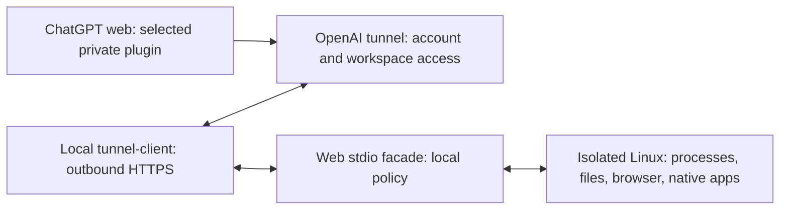

# ChatGPT web connection to isolatedLab

ChatGPT on the web can use the lab's structured guest tools through a private OpenAI Secure MCP Tunnel. A local tunnel client forwards requests to the lab's stdio interface and returns JSON results. The guest interface already reads files, process output, browser DOM/ARIA and native Linux AT-SPI controls; screenshots are an optional observation route. This does not grant the web chat host desktop input.

The local facade is separate from the running 0.3.0 guest runtime. Preparation starts neither a VM nor an internet connection. A web chat cannot start/stop the VM through this facade; its lifecycle stays with the local owner. Use a dedicated accepted guest for web actions so different chats do not share its workspace or sessions. This release does not implement a concurrent workflow scheduler.

## Current evidence

| Layer | Observed on the reference Windows host |
|---|---|
| Official client | Windows amd64 v0.0.16 downloaded privately; ZIP hash agrees with official SHA256SUMS; executable/version read back |
| Local transport | Six checks pass through the real vendor local dev proxy, actual stdio child and selected lab status |
| Local policy/recovery | Thirteen tests pass: blocked actions/lifecycle, no remote policy expansion, duplicate-key retrieval across facade restart, unknown-outcome refusal and nonzero-result preservation |
| Existing guest tools | Prior 0.3.0 build/browser/GTK native acceptance retained; no guest provider changed |
| Platform and ChatGPT | **PENDING_ACCOUNT_ACTIVATION**; Platform Login observed, no real tunnel ID/key or workspace association available |
| Web application work | **NOT_TESTED**; requires an actual installed ChatGPT plugin and a dedicated guest |
| Windows and user parallel work | Windows unprovisioned; owner-observed simultaneous-work test remains separate |

Local test success is not proof of internet account access, actual ChatGPT tool selection, or unlimited unattended operation. A tunnel requires the computer and client to remain available. Guest operation deadlines remain 500–60000 ms, and cloud transport can impose a shorter response deadline. A timeout may occur after an action started; inspect before replaying. Long builds need bounded steps or a separately accepted guest job adapter.

## Activate the selected private connection

1. Sign in to [Platform tunnel settings](https://platform.openai.com/settings/organization/tunnels). Create a tunnel in the intended personal Platform organization and associate the target ChatGPT workspace. Creation needs Tunnels Read + Manage; runtime use needs Read + Use. Verify actual account eligibility; a ChatGPT subscription alone is not evidence of tunnel permission. Do not add unrelated organizations/workspaces.
2. Prepare locally with `prepare_web_connection.py --config <private-config> --download-client`, or select the already verified private executable using `--client`. It writes `private/web-connection-0.5.0/plan.json`, facade, launcher and **read-only** policy. Existing runtime source/VM state stay intact. Review latest [official client release](https://github.com/openai/tunnel-client/releases/latest) when upgrading; the supplied lock preserves the reviewed version's exact bytes.
3. Run the prepared `Connect-WebLab.ps1 -Plan <plan.json> -Action init -TunnelId <full-platform-id>`. This uses the official CLI to create the private stdio profile, with a loopback-only ephemeral health listener and an environment secret reference. No key is written to the plan/profile/source bundle. Run `-Action doctor`, supplying the runtime key through its hidden terminal prompt or an existing process environment. Do not paste a key into chat. After doctor succeeds, `-Action run` starts the selected foreground connection, serializing MCP dispatch. It does not open a browser or change input/display. Closing it disconnects the web tools. No login/startup service or stored credential is configured by this release.
4. While the client is healthy, open [ChatGPT Plugins](https://chatgpt.com/plugins), choose **Add custom MCP server**, name it `isolatedLab`, and select **Tunnel** plus the verified ID. Configure the appropriate authentication and create/install the personal plugin. The stdio facade does **not** implement OAuth. For an explicitly private single-owner connection, **No authentication** means no additional app-level OAuth: access relies on the OpenAI tunnel's organization/workspace controls. It is not suitable for a publicly reachable or broadly shared command endpoint. Use a separate authenticated server before broader distribution. Review the actual recipient/scope before granting account access.
5. In a new web chat, select `@isolatedLab` and request `lab_status`, followed by tool discovery/inspection of only the selected task. Verify that exactly `lab_status` and `linux_inspect` are available in read-only mode, and that `linux_action`, VM stop and a mutation submitted as inspection are rejected. Record the real web replies separately from the local proxy receipt.

The observed reference machine has a prepared plan and verified client, but no live account connection. Sign-in is the next prerequisite. The installed personal Codex skill includes this route; registering a web plugin is an additional account-level step and does not happen through skill installation.

## Enable guest actions and prove the workflow

Use a separate prepared/accepted lab for the web workflow, or wait for the current owner and explicitly dedicate its guest. Preparation does not establish exclusive ownership. Locally select `{"schema":1,"mode":"guest-actions","dedicated_guest":true}` in that connection's policy only after ownership is established. A remote argument cannot do this. Refresh the ChatGPT plugin catalog after changing policy. Setting mode to `disabled` locally immediately blocks guest calls even with a cached remote catalog; `lab_status` remains available. Disconnect the client to remove the route entirely.

Start/wait-ready with the accepted local controller. Then use this web acceptance sequence:

1. Inspect `capabilities` and `system.status`. Record the selected guest and provider versions.
2. Write a uniquely named guest workspace file, run a small build/test using guest argv, and read back its content, exit status and output. Give every action a unique `request_key` of 16–80 letters/digits/underscore/hyphen. Resending the **same key and payload** retrieves its recorded response without executing again. A different payload using that key is rejected. A crash without a recorded response yields `OUTCOME_UNKNOWN`; inspect guest state before deciding what to do next. This is a local duplicate guard, not an exactly-once guarantee across disk loss, replaced lab roots or new keys.
3. Open a task-owned browser session, inspect DOM/ARIA, perform one selected fill/click, inspect the result, then close that session. Do not import host browser profiles/cookies.
4. Open a native desktop session, launch the accepted demo/application in its private guest D-Bus/Xvfb environment, inspect its AT-SPI tree, use the current snapshot hash/control ID and an exposed action, then read back the result. Unsupported custom controls need an adapter or guest screenshot. Linux GTK acceptance does not establish universal native-app control.
5. Test a bounded failing/timeout operation, stale session/state and a disconnected tunnel. Require explicit failures, recovery by observation and no automatic replay. A completed transport request with a nonzero application exit is still a failure.
6. While the web chat repeats a selected workload for 5–10 minutes, use the host normally. Record mouse, keyboard, focus and display interference plus responsiveness. Prior unattended guest acceptance does not replace this owner observation. Close only task-owned sessions; stop the dedicated guest locally and verify client/guest listeners close as intended.

Retain private receipts and record account/plugin/tool names, tested actions, failures, clean shutdown and recovery. Do not publish keys, disks, machine bindings, private project data or raw logs. Selected guest tool data is transmitted to the connected ChatGPT context; transfer only data needed for the user's task.

Transport, authentication and recovery details

The official client makes outbound HTTPS requests to OpenAI. No inbound firewall rule, public host MCP port or browser extension is required. Its admin UI is loopback-only. The local acceptance uses the vendor's ephemeral HTTP dev proxy, with no real account key; that fixture is not the production endpoint.

Run one active stdio client per tunnel ID. Multiple clients can route initialization and later calls to different children; even restart overlap is unsupported. Stop the old client before replacement. Preserve its profile and source hashes, diagnose doctor/health/readiness failures, and confirm the new runtime before reporting reconnection.

For a long-lived locally managed connection, official `tunnel-client runtimes connect`/`status --json` can supervise it. Use verified CLI help and an explicit local secret reference; inspect `process_running`, `healthy` and `ready`. This release has not activated or accepted managed supervision/reboot recovery on this account. A missing runtime secret after restart is a failure, not a reason to save an unprotected key or bypass authentication.

OAuth discovery can travel through the tunnel, but the authorization server must be reachable for browser-facing flows. Tunnel transport and application OAuth are different boundaries. Public plugin distribution requires a stable public HTTPS MCP endpoint and separately reviewed authentication; it is outside this personal connection's scope.

The facade strips local transport receipt paths from normal guest results and removes tunnel API-key environment variables from its child environment. It does not redact arbitrary selected guest content. Action journal files remain private and survive facade restarts; they are excluded from portable source packages. Preserve unknown-outcome records rather than deleting them to make a retry run.

## Reuse on another computer

The 0.5.0 verified source bundle carries the facade, launcher, lock and procedure. Install/bind the skill and accept the destination guest using [portability](ISOLATED-LAB-PORTABILITY.md), then prepare this web connection locally. Do not transfer runtime/API keys, account cookies, the old machine plan or guest SSH identity. Use one new/selectively associated tunnel for the selected machine and verify both local and real web acceptance. A second computer has not been tested in this session.

[Official Secure MCP Tunnel guide](https://developers.openai.com/api/docs/guides/secure-mcp-tunnels) · [Custom MCP server in ChatGPT](https://developers.openai.com/api/docs/guides/custom-mcp-server) · [Plugin authentication](https://developers.openai.com/plugins/build/auth)

Design: the required route/status is visible; optional transport depth uses one disclosure. The guide keeps existing selected paths/modes explicit and links the operating procedures instead of introducing another setup UI.
