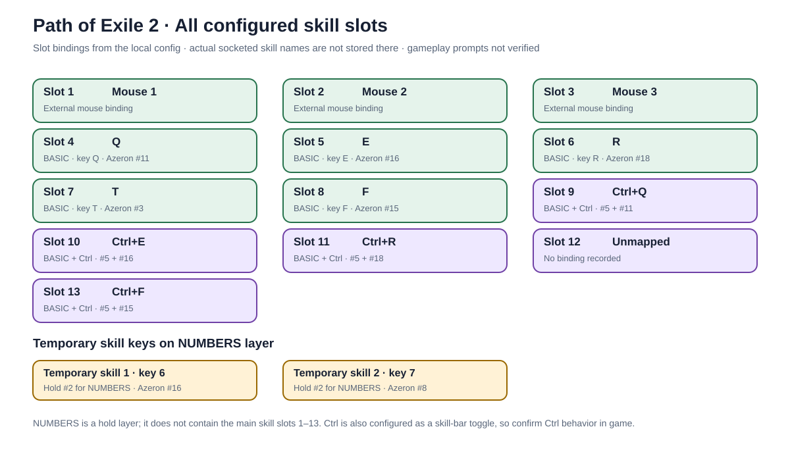
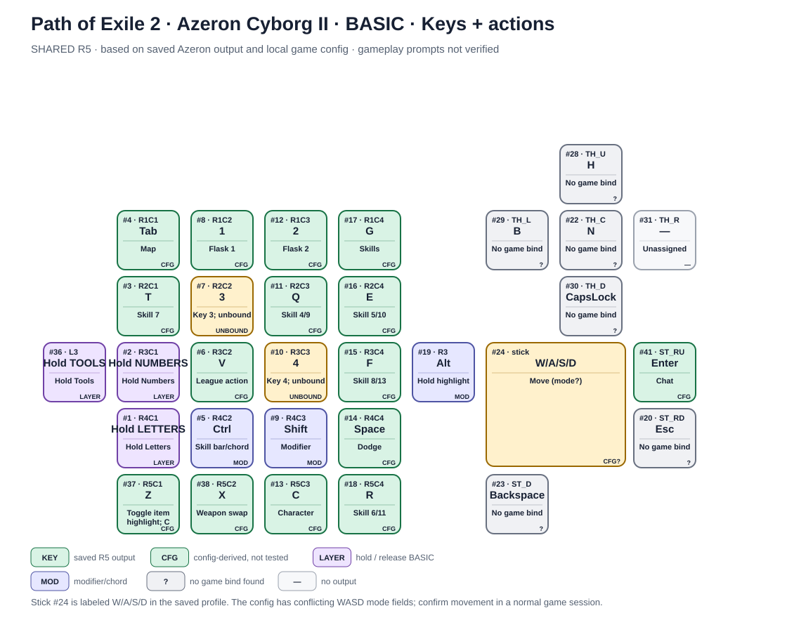

# Path of Exile 2 — Azeron Cyborg II keymap

## Latest layout — GROUPED R2

The user requested a more intuitive layout with related skills together for every
build. The new **PATH OF EXILE 2 - GROUPED R2 COMBAT** and **PATH OF EXILE 2 -
GROUPED R2 MENU** files were added alongside the current profiles on 2026-10-12.
Three adjacent towers contain all 13 skill inputs. Flasks #4/#3 are adjacent;
main and Ctrl skill keys form four same-row pairs; Dodge remains at #14.
MENU groups character panels and maps.

See [the grouped R2 guide](grouped-r2/README.md) and
[authoritative R2 mapping](grouped-r2/KEYBINDS-GROUPED-R2.json).
R2 active selection and physical/game behavior remain pending.

The sections below preserve the historical SHARED R5 and first PoE2 proposal.

## Current PoE 2 profile pair

On 2026-10-12, the first native pair **PATH OF EXILE 2 - COMBAT** / **PATH OF EXILE 2 - MENU** was added. The user subsequently confirmed it appeared after fully ending Azeron Software through Task Manager. Later readback found the user's immediate #1 MENU selector; #6 had V but no layer target. R2 preserves the earlier files and restores #6's 150 ms long layer hold using native type 24. Physical transitions remain unverified.

The saved map below is still the historical SHARED R5 reference; the installed pair is documented in [the profile-pair setup note](azeron-profile-pair/README.md).

## Status

- Device: Azeron Cyborg II, matched to the saved R5 installation report; Azeron Software 2.0.2.
- Profile family: SHARED R5 — BASIC, NUMBERS, LETTERS, TOOLS. BASIC was selected in the saved report; current selection was not re-read.
- Game input: the config selects WASD and defines the `[WASD_ACTION_KEYS]` section. The conflicting `use_wasd_to_move=false` field means movement mode still needs an in-game check.
- Verification: the R5 report records the #1/#2/#36 hold-layer transitions checked outside the game. Gameplay actions, prompts, stick travel, and current runtime state remain unverified.

## BASIC — combat and movement

| Azeron input | Output | Configured PoE 2 action |
|---|---|---|
| Stick #24 | W/A/S/D | Move (verify the active input mode) |
| #8, #12 | 1, 2 | Flask slots 1, 2 |
| #7, #10 | 3, 4 | Keys 3 and 4; flask slots 3 and 4 are unbound |
| #11, #16, #18, #3, #15 | Q, E, R, T, F | Skill slots 4–8 |
| Hold #5 with Q/E/R/T/F | Ctrl+Q/E/R/T/F | Skill slots 9–13 |
| #14 | Space | Dodge roll |
| #37, #38 | Z, X | Toggle item highlight, weapon swap |
| #4, #13, #17 | Tab, C, G | Map, character panel, skill panel |
| #41 | Enter | Open chat |
| Hold #1 / #2 / #36 | — | Hold LETTERS / NUMBERS / TOOLS; release returns to BASIC |

**Ctrl overlap:** Ctrl also toggles the secondary skill bar and appears in the configured Ctrl+U and Ctrl+Z actions. Confirm how these interact with skill chords in game.

## All configured skill slots

The saved game config names skill slots, not the abilities socketed into them. This is the complete recorded input map:

| Skill slot | Input | Azeron layer / control |
|---:|---|---|
| 1 | Mouse 1 | External mouse |
| 2 | Mouse 2 | External mouse |
| 3 | Mouse 3 | External mouse |
| 4 | Q | BASIC, #11 |
| 5 | E | BASIC, #16 |
| 6 | R | BASIC, #18 |
| 7 | T | BASIC, #3 |
| 8 | F | BASIC, #15 |
| 9 | Ctrl+Q | BASIC, hold Ctrl on #5 with #11 |
| 10 | Ctrl+E | BASIC, hold Ctrl on #5 with #16 |
| 11 | Ctrl+R | BASIC, hold Ctrl on #5 with #18 |
| 12 | Ctrl+T | BASIC, hold Ctrl on #5 with #3 |
| 13 | Ctrl+F | BASIC, hold Ctrl on #5 with #15 |

NUMBERS is a separate hold layer, not where the main skill slots live. It adds temporary skill 1 on key 6 at #16 and temporary skill 2 on key 7 at #8 while holding #2. The actual names of the slotted abilities are not present in the binding config.

## Hold layers

- **NUMBERS** — hold #2. #6/#10/#15 emit 1/2/3, #7/#11 emit 4/5, #16 emits 6 (temporary skill 1), #8 emits 7 (temporary skill 2); #13 emits 0. Hold #2 again/release to return to BASIC per saved profile behavior.
- **LETTERS** — hold #1. #8 emits I (inventory), #17 K (cosmetics), #6 P (passives), and #10 U (Ctrl+#5 makes Ctrl+U for Atlas passives). Letter and arrow outputs without matching current game bindings are shown as unassigned in the action diagram.
- **TOOLS** — hold #36. #28 emits Home for the configured OptiScaler menu shortcut. The other function/navigation keys are retained as saved; their actions are marked where no current game/mod binding is available.

## Layer diagrams

Each layer has a keys view, an action view, and a combined view. The skill-slot overview above includes all 13 main slots and the two temporary skill keys. `CFG` means derived from a configuration file, not verified in gameplay. `LAYER` marks a saved hold-layer control; `MOD` marks a modifier; `?` means no matching game action was found; `—` means that layer has no output at that control. The stick is W/A/S/D in the saved layout; its direction, travel, click, and game response are not physically verified here.

### BASIC

| View | File |
|---|---|
| Keys | [basic-keys.svg](azeron-keymap/basic-keys.svg) |
| Actions | [basic-actions.svg](azeron-keymap/basic-actions.svg) |
| Combined | [basic-combined.svg](azeron-keymap/basic-combined.svg) |

### NUMBERS

| View | File |
|---|---|
| Keys | [numbers-keys.svg](azeron-keymap/numbers-keys.svg) |
| Actions | [numbers-actions.svg](azeron-keymap/numbers-actions.svg) |
| Combined | [numbers-combined.svg](azeron-keymap/numbers-combined.svg) |

### LETTERS

| View | File |
|---|---|
| Keys | [letters-keys.svg](azeron-keymap/letters-keys.svg) |
| Actions | [letters-actions.svg](azeron-keymap/letters-actions.svg) |
| Combined | [letters-combined.svg](azeron-keymap/letters-combined.svg) |

### TOOLS

| View | File |
|---|---|
| Keys | [tools-keys.svg](azeron-keymap/tools-keys.svg) |
| Actions | [tools-actions.svg](azeron-keymap/tools-actions.svg) |
| Combined | [tools-combined.svg](azeron-keymap/tools-combined.svg) |

## Sources and next check

The map uses the current PoE 2 local config and sanitized SHARED R5 report/map references; private paths and profile IDs are omitted. See [HISTORY.md](HISTORY.md) for the config hash, limits, and rollback. During a normal game session, confirm movement mode, numbered prompts, skill chords, layer return, and the Home menu shortcut before treating this as gameplay-verified.

## PoE 2-specific COMBAT / MENU proposal

The separate profile-pair proposal follows the requested quick-access pattern: finger controls carry the COMBAT and MENU assignments, while thumb menu shortcuts remain available in both views. It is a design preview only. The SHARED R5 profiles remain unchanged, and the proposed pair has not been installed or checked in game.

| Layer view | PNG preview | Editable SVG |
|---|---|---|
| COMBAT | [poe2-proposal-combat-icons.png](azeron-keymap/overlay/poe2-proposal-combat-icons.png) | [poe2-proposal-combat-icons.svg](azeron-keymap/overlay/poe2-proposal-combat-icons.svg) |
| MENU | [poe2-proposal-menu-icons.png](azeron-keymap/overlay/poe2-proposal-menu-icons.png) | [poe2-proposal-menu-icons.svg](azeron-keymap/overlay/poe2-proposal-menu-icons.svg) |

Both images mark the proposed layer key: tap #6 emits V; a 150 ms hold enters MENU; release returns to COMBAT. The thumb menu actions stay visible in both views. `PROPOSED`, `CFG`, `OVERLAP`, `KEY ONLY`, and `MODE ?` distinguish new mappings from config-derived or still-unverified actions.

The earlier `poe2-overlay-plain` and `poe2-overlay-icons` files show both contexts together. Use the two new layer-specific views when the overlay host supports automatic layer selection. See [OVERLAY-NAVIGATION.md](OVERLAY-NAVIGATION.md) and [overlay-manifest.json](overlay-manifest.json) for the proposed selection contract and review limits.
