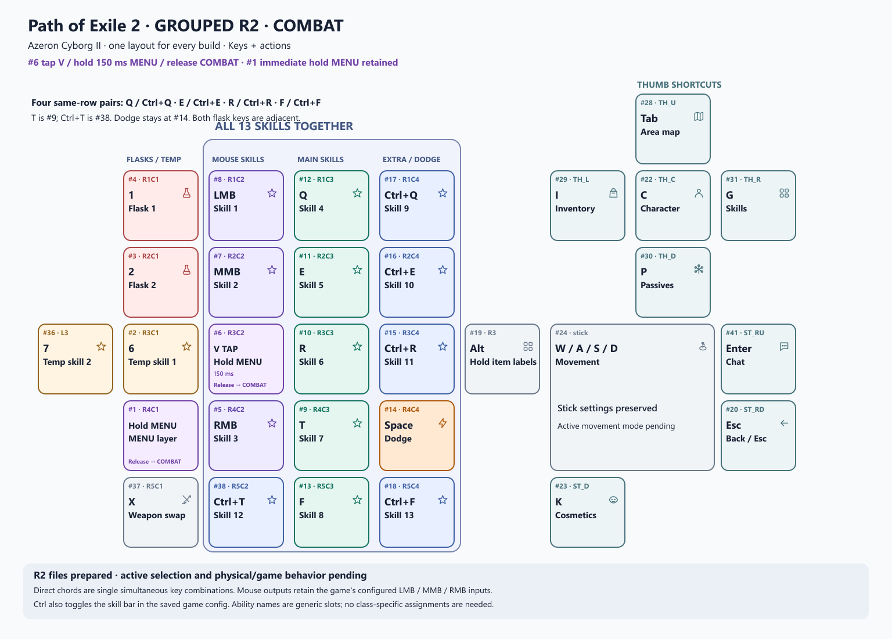
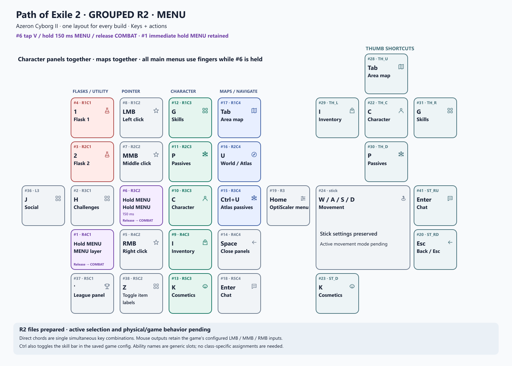

# Path of Exile 2 — GROUPED R2

**One skill layout for every build.** All 13 configured skill inputs are in the
three adjacent skill towers. The two flasks are next to each other on the other
tower. MENU groups character panels together and maps together.

Profiles: **PATH OF EXILE 2 - GROUPED R2 COMBAT** and
**PATH OF EXILE 2 - GROUPED R2 MENU**.

## Combat layout

| Cluster | Azeron buttons | Outputs / role |
|---|---|---|
| Mouse skills | #8 / #7 / #5 | LMB / MMB / RMB — skill slots 1 / 2 / 3 |
| Main keyboard skills | #12 / #11 / #10 / #9 / #13 | Q / E / R / T / F — slots 4–8 |
| Extra skills | #17 / #16 / #15 / #38 / #18 | Ctrl+Q / Ctrl+E / Ctrl+R / Ctrl+T / Ctrl+F — slots 9–13 |
| Flasks | #4 / #3 | 1 / 2 — configured flask slots 1 / 2 |
| Temporary skills | #2 / #36 | 6 / 7 — adjacent main/side positions |
| Dodge | #14 | Space — retains the previous Dodge position |
| Weapons / loot | #37 / #19 | X weapon swap / hold Alt for item labels |

Q, E, R and F each have their Ctrl variant directly beside them in the same row.
T's Ctrl variant is at #38 because #14 keeps Dodge. All five Ctrl combinations
have their own button; each emits one simultaneous chord, with no repeated
casts or sequence macro. The three mouse inputs are also available on the
Azeron, so all 13 slots are reachable in COMBAT.

## Menu layout

| Cluster | Azeron buttons | Panels |
|---|---|---|
| Character | #12 / #11 / #10 / #9 / #13 | Skills / Passives / Character / Inventory / Cosmetics |
| Maps | #17 / #16 / #15 | Area map / World or Atlas / Atlas passives |
| Navigation | #14 / #18 | Space to close panels / Enter for chat |
| Other panels | #2 / #36 / #37 | Challenges / Social / League panel |
| Tools | #19 | Home for the saved OptiScaler menu shortcut |

The main menu controls use the other fingers while #6 is held. The thumb
shortcuts remain available on both layers. Flasks remain at #4/#3 in MENU.
The pointer buttons and item-label toggle at #38 can be reached with the
alternative #1 layer hold when the ring finger is free.

## Layer controls and selection

- **#6:** short tap emits V on release; a 150 ms hold enters MENU; release returns
  to COMBAT. The R2 native files encode Long Press layering as type 24.
- **#1:** keeps the newer immediate momentary MENU shortcut found in the user's
  current profiles. Release returns to COMBAT.
- Two new native JSONs are added alongside the existing profiles. The user's
  existing PoE2 and SHARED R8 profiles keep their own IDs and files.
- After the current session, fully exit Azeron Software, reopen it, and select
  **PATH OF EXILE 2 - GROUPED R2 COMBAT**. A window close may only minimize the
  program; the user previously confirmed that ending it through Task Manager
  made the earlier pair appear.

## Files

- `KEYBINDS-GROUPED-R2.json`: authoritative physical-position/action record.
- `native-profiles/`: the two native Azeron profile files.
- `combat-keys.svg`, `combat-actions.svg`, `combat-combined.svg`: three views.
- `menu-keys.svg`, `menu-actions.svg`, `menu-combined.svg`: three views.
- `combat-icons.png`, `menu-icons.png`: icon-led overlay images.
- `overlay-handoff.json`: exact profile/image references for later integration;
  this is descriptive metadata, not an imported Hub registry.
- `INSTALL-RECEIPT.json`: configuration addition and recovery details.

Configuration evidence, limits and recovery

The output keys come from the current `WASD_ACTION_KEYS` section. The skill
labels identify configured slots, not a particular class's abilities. Mouse
buttons are decoded using [Microsoft's virtual-key definitions](https://learn.microsoft.com/en-us/windows/win32/inputdev/virtual-key-codes)
and the installed Azeron 2.0.2 renderer's mouse enumeration.

Configuration generation/readback and rendered pictures are separate from
physical usability and game acceptance. Active profile selection, quick taps,
held layer transitions, Ctrl skill-bar interactions, movement and game prompts
remain unobserved. The saved game config still selects WASD while also storing
`use_wasd_to_move=false`. No game configuration is changed by this package.

Shift attack-in-place remains on the external keyboard. Slots 3–5 in the old
five-flask configuration are unbound and receive no dedicated combat buttons.
The current Azeron software and game session are not interrupted by adding the
R2 library files. Overlay-host activation is a separate remaining integration.

The receipt names the just-in-time private backup. It preserves all existing
native software profile files and available global JSONs. IndexedDB and onboard
hardware are outside this snapshot's coverage. To remove R2, fully close Azeron
Software and remove only profile IDs `0ca7e8e3-131e-5f6b-8a8d-9a0dd78c0b17`
and `4943b051-848c-5389-aa4d-e835b6dfd1e2`, then reopen. The earlier known-good
archive and current user-edited PoE2 pair remain separate recovery sources.

